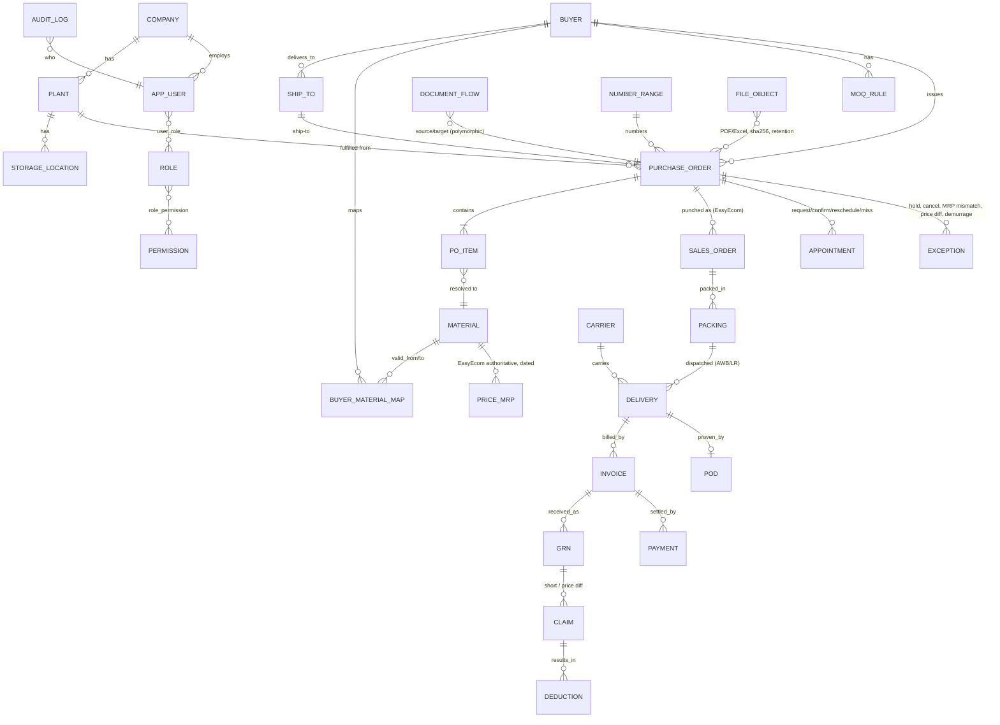

# Data model (SAP-style), Phase 1 target

Money columns are `bigint` paise. Business dates are `date`; timestamps `timestamptz`. Every table has `company_id` (row-level security), `created_by/at`, `updated_by/at`.

Key rules: posted documents immutable (status `POSTED` → only `REVERSED` via a reversal document); `DOCUMENT_FLOW(source_type, source_id, target_type, target_id, link_type)`; `AUDIT_LOG(user, at, object_type, object_id, field, old, new, reason)` written in the same transaction as the change.
